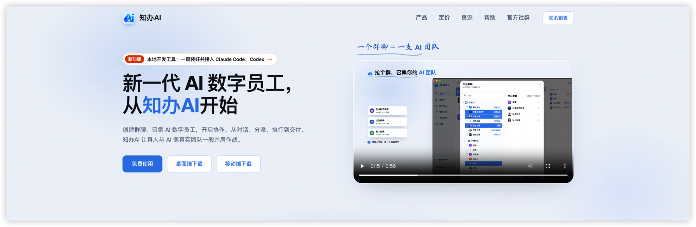
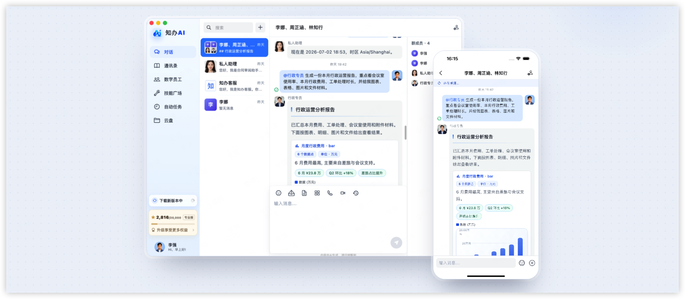
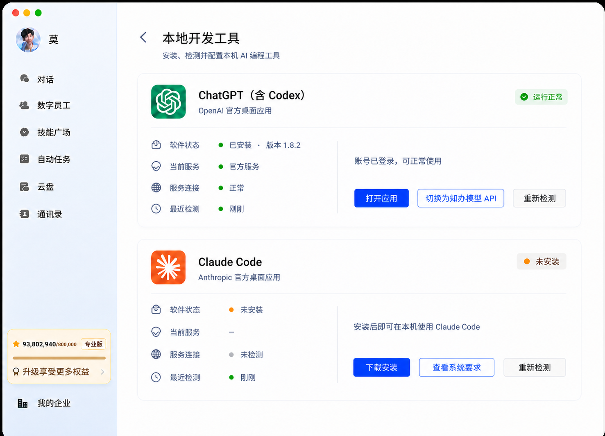
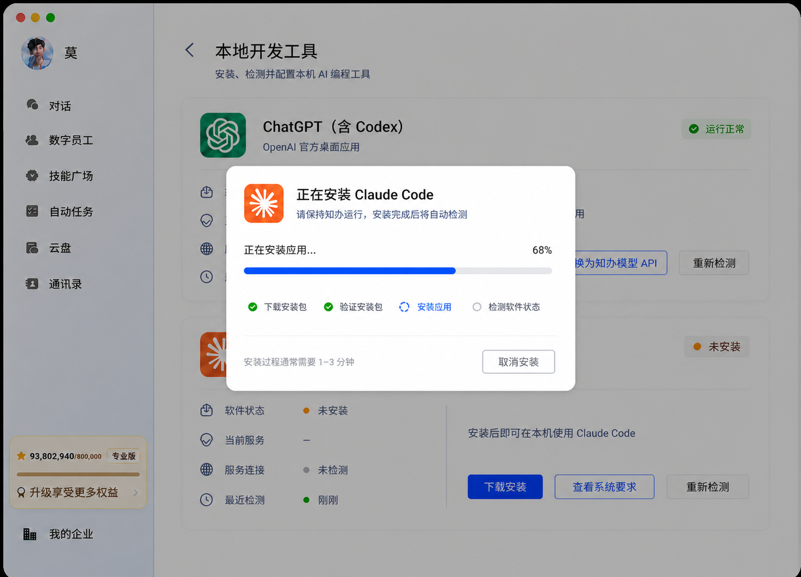
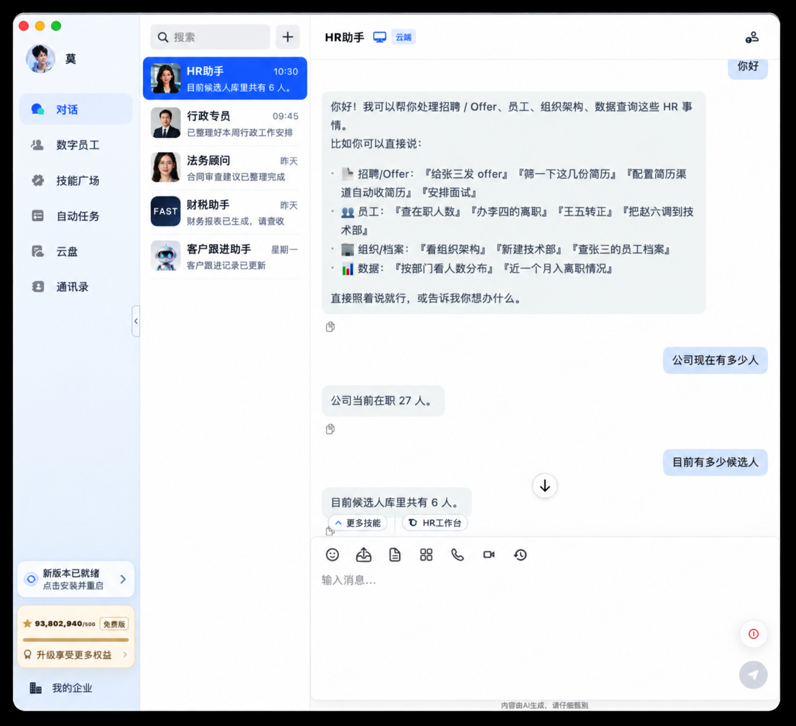
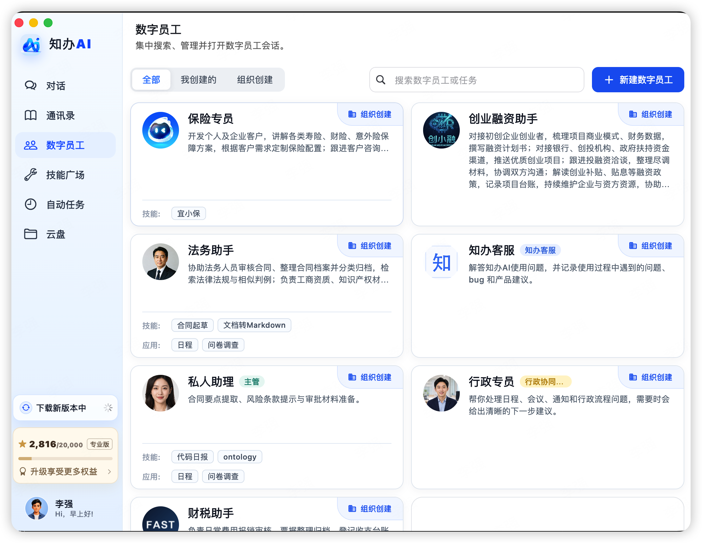
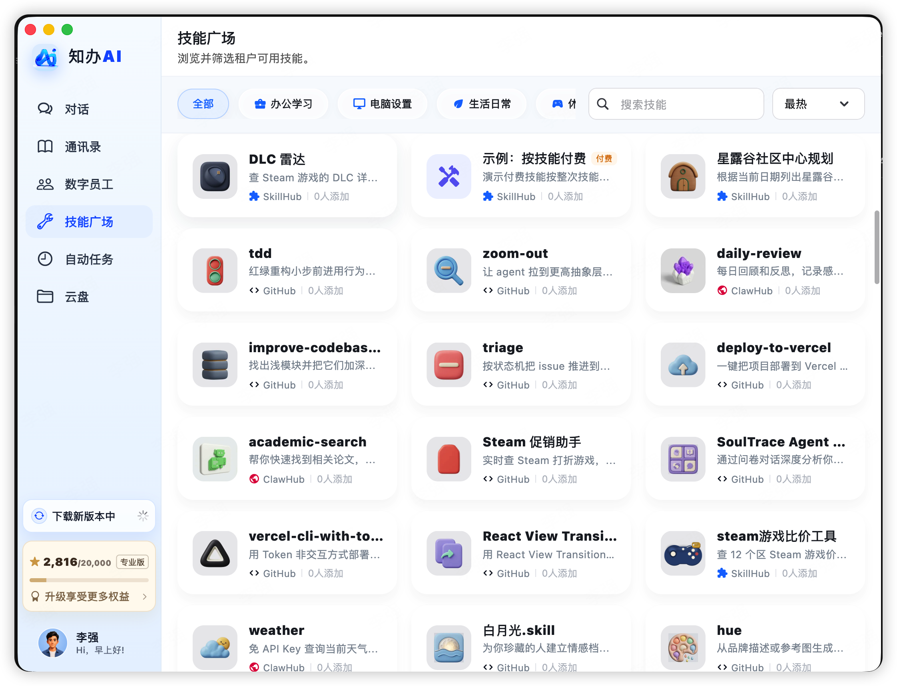
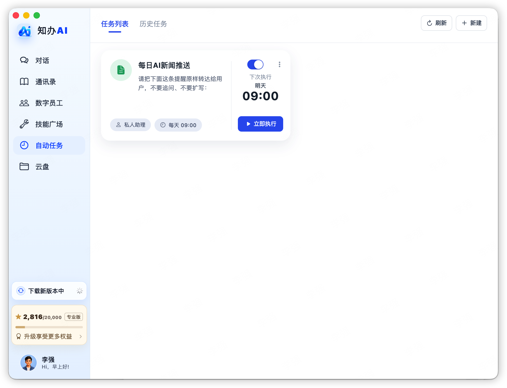
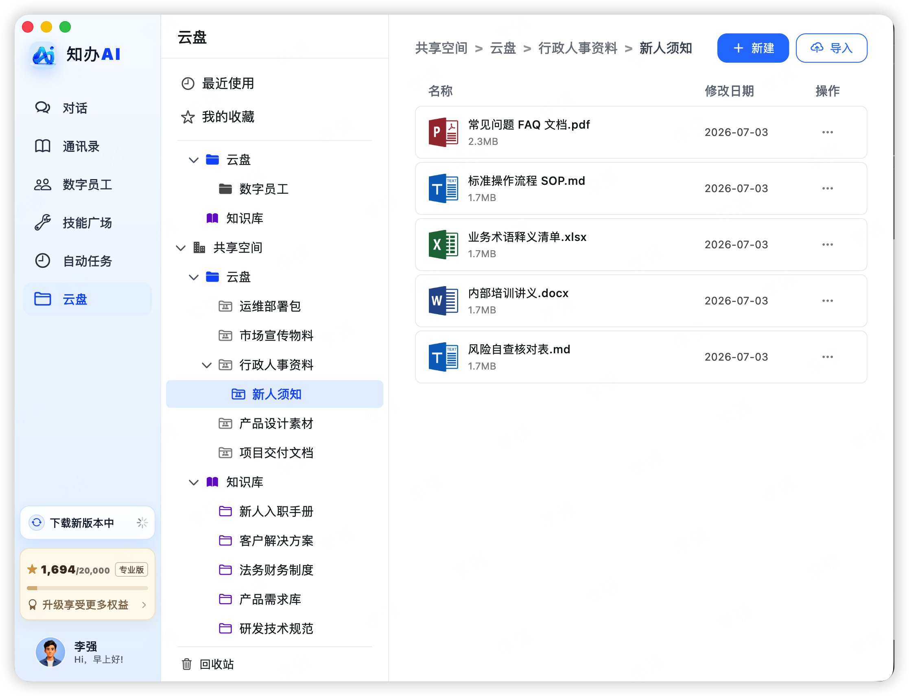

# 知办AI · Zhiban AI

<p>
  
</p>

**让数字员工加入你的团队，在自己的环境里开展 AI 协作。**

知办AI 是面向团队的 AI 协作平台，你可以把它理解为开源版本的“Workbuddy”：把对话、数字员工、技能与文件放进同一个工作空间，让 AI 参与日常工作。项目提供桌面客户端、服务端、管理台和 Agent 接入能力，支持自行部署。你可以从本地 Mock 助手开始，再按需接入自己的模型与运行时。

[快速开始](docs/INSTALL.md) · [反馈问题](https://github.com/zbwork/zhiban-ai/issues) · [参与贡献](CONTRIBUTING.md) · [官网](https://www.zbwork.cn/)

## 为什么做知办AI

和 AI 聊天只是开始。团队还需要知道：谁可以使用哪个数字员工、对话与文件放在哪里，以及如何把自己的 Agent 接进来。知办AI 将这些协作要素放在一起，帮助开发者和团队搭建自己的 AI 工作空间。

- **以数字员工组织协作**：在管理台配置员工，进入客户端开始对话。
- **在自己的环境里部署**：社区服务使用自己的数据库、对象存储和模型配置。
- **从演示走向集成**：先用默认 Mock 助手跑通链路，再对接自己的模型和 Agent；Mock 不会调用真实大模型。
- **客户端与管理职责分开**：桌面面向日常使用，管理台负责租户、员工与组织管理。

## 功能一览

### Codex 与 Claude Code 一键安装

在「本地开发工具」中安装、检测和配置 Codex、Claude。点击各工具的「API 设置」，填写自己的 API 地址、模型名称和 API Key，再应用配置并检测连接。API Key 仅保存在本机安全凭据库。Codex 需使用支持 OpenAI Responses 的服务，Claude 需使用支持 Anthropic Messages 的服务。





### 与数字员工对话

在同一工作空间中与数字员工沟通，查看回复与业务信息。



### 数字员工

集中浏览个人与组织数字员工，按职责找到合适的协作对象。



### 技能广场

按分类浏览与搜索技能，了解可扩展的工作能力。



### 自动任务

查看任务计划、启停任务，并在需要时立即执行。



### 文件与云盘

通过目录整理工作资料，集中查看文件与共享空间。



## 核心模块

| 模块 | 用途 |
|---|---|
| 桌面客户端 | 提供 macOS / Windows 桌面源码，通过账号密码登录自己的工作空间 |
| 对话与消息 | 会话列表、消息历史与流式回复，使用 WuKongIM 处理实时消息 |
| 数字员工 | 创建、编辑、发布和管理数字员工，按个人与组织职责开展协作 |
| 租户与组织 | 管理租户、成员和部门，通过服务端权限控制访问 |
| 文件与云盘 | 使用对象存储整理工作文件，支持基础上传、下载和目录管理 |
| 自动任务 | 创建执行计划，启停或立即运行任务，并从历史记录定位结果 |
| 技能与知识库 | 浏览技能目录与知识库列表，发现工作场景所需的资源 |
| Agent 集成 | 通过社区后端与 DSH 运行时源码扩展自己的 Agent |

## 从本地开始

需要 Docker Compose v2、OpenSSL，以及下载公开依赖和镜像的网络。

1. 进入 `deploy/community`，将 `.env.example` 复制为 `.env`。
2. 按[安装说明](docs/INSTALL.md)为数据库、对象存储与消息回调配置不同的随机口令。
3. 执行 `./community-up.sh`，构建并启动社区服务。
4. 按安装说明通过标准输入执行 `./bootstrap.sh`，创建初始管理员。
5. 打开管理台，登录并创建租户，使用默认 Mock 助手开始验证。

| 本地入口 | 地址 |
|---|---|
| 社区管理台 | http://127.0.0.1:18082 |
| 客户端 Bus API | http://127.0.0.1:18080 |
| 管理 API | http://127.0.0.1:18081 |
| WuKong WebSocket | ws://127.0.0.1:18083 |

端口默认只绑定本机。桌面源码构建、SDK 准备、Bus 地址配置、停止服务和备份操作，请遵循完整的[安装与启动指南](docs/INSTALL.md)。账号由部署者初始化，使用账号密码登录。

## 配置模板

独立配置模板仓库：[zbwork/zhiban-ai-config](https://github.com/zbwork/zhiban-ai-config)。模板按 development / test / production 和组件分类，提供环境变量、Agent Bus YAML、客户端编译参数及运行时配置的字段参考。

快速开始使用本仓库 deploy/community 下的 .env.example 和 service.yaml 配置服务。需要单独管理多环境配置、客户端编译参数或运行时设置时，可以参考模板仓库，并在启动或构建时指定配置路径。

使用模板时：

1. 选择所需环境与组件，复制对应的 .example 文件，并去掉文件名末尾的 .example。例如 .env.example → .env、bus.yaml.example → bus.yaml。
2. 按组件要求填写自己的服务地址、口令、模型参数及证书路径。空字符串、0 和 false 都是占位，不能直接作为可运行配置。
3. 按组件启动或构建说明显式指定配置路径；不要把整套模板直接覆盖到 deploy/community，两个目录的配置格式与加载入口可能不同。
4. 真实配置只保存在本地或部署环境。模板仓库的忽略规则用于阻止本地配置入库，提交前仍需检查暂存文件，不能把真实值写回 .example。

按需选择配置模板并填写自己的参数，详细操作见[配置模板 README](https://github.com/zbwork/zhiban-ai-config#readme)。

## 项目结构

```text
apps/
  zhiban-app/          桌面客户端（Flutter）
  agent-bus-admin/     社区管理台（React / TypeScript）
  zhiban-local-bridge/ 本地桥接（Go）
packages/             客户端共享业务、UI 与契约
services/
  agent-bus/          社区 API、worker 与数据库迁移（Go）
  dsh-runtime/        Agent 运行时适配（TypeScript）
deploy/community/    Docker Compose 与初始化工具
third_party/         随源码保留的第三方组件
```

## 适合谁

- 想搭建内部 AI 协作环境、愿意自行部署和维护的团队。
- 希望对接自有 Agent、模型或业务系统的开发者。
- 希望研究桌面、管理台、服务端协作实现的开源使用者。

## 参与社区

欢迎通过 [GitHub Issues](https://github.com/zbwork/zhiban-ai/issues)反馈问题和提出建议。提交问题时请附系统版本、复现步骤和脱敏后的日志。代码及文档贡献政策见[贡献指南](CONTRIBUTING.md)。

- [支持渠道](SUPPORT.md) · [安全漏洞私密报告](SECURITY.md)
- [行为规范](CODE_OF_CONDUCT.md) · [维护流程](GOVERNANCE.md)
- [更新记录](CHANGELOG.md) · [第三方声明](THIRD_PARTY_NOTICES.md)

## 许可与商业授权

知办AI社区版采用标准 [GNU Affero General Public License 第 3 版（AGPL-3.0）](LICENSE)，允许遵守适用条款的商业使用。第三方组件保留各自许可与归属。

如需获得 AGPL 义务豁免，可另行协商商业授权，具体范围以双方协议为准。请访问[知办AI 官网](https://www.zbwork.cn/)的“联系销售”入口。

版权署名：知办团队。项目名称与标识不代表对第三方服务或衍生产品的背书。
