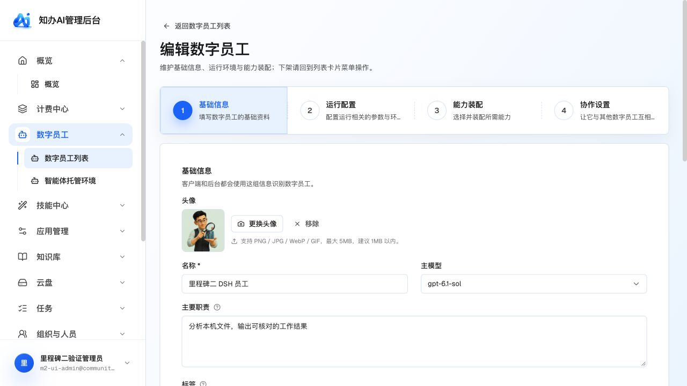
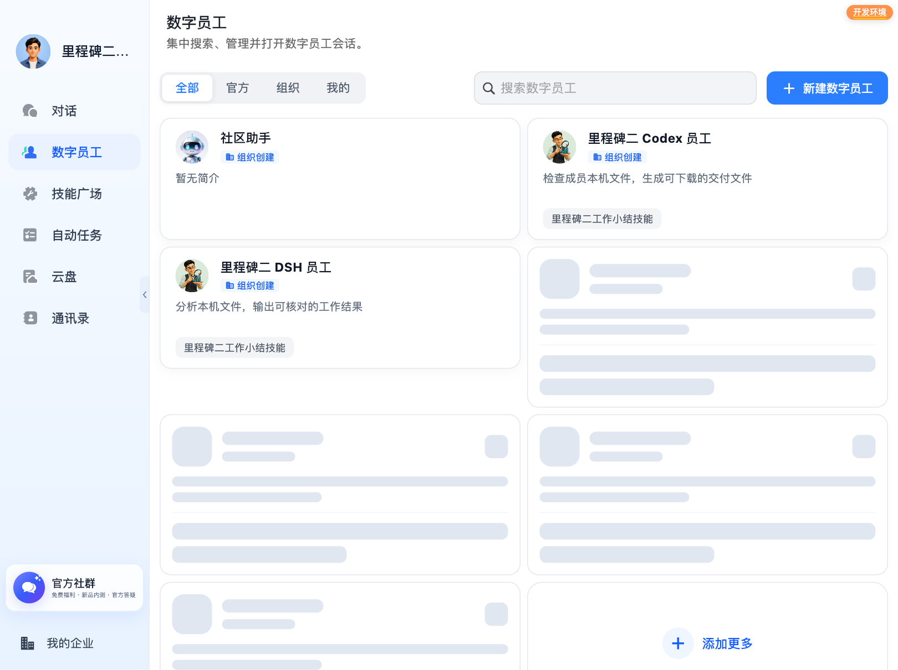
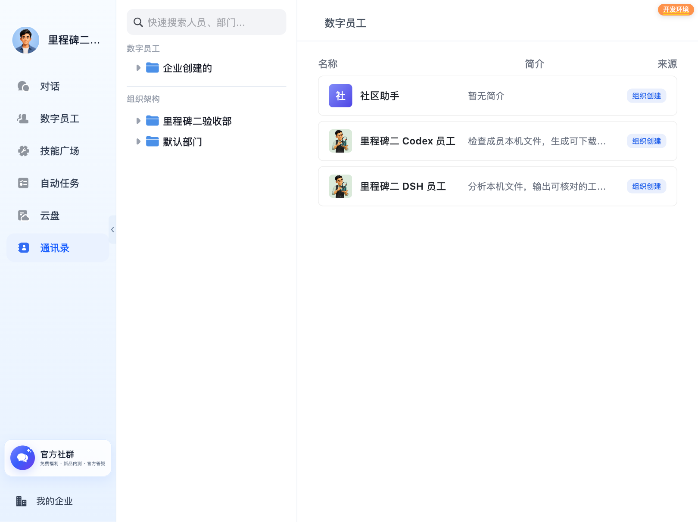
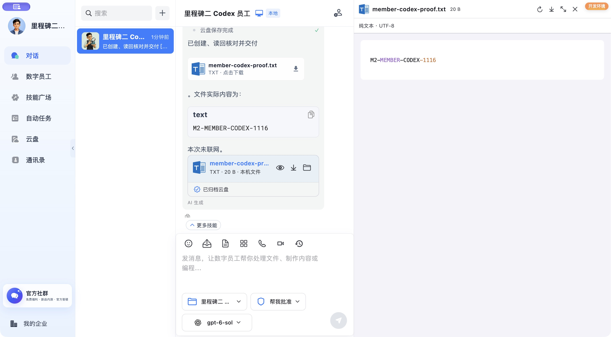

# 里程碑二：后台到客户端实机验收

日期：2026-11-16～17。本次全部使用本机独立 Compose 项目 `zhiban-community-local-20261113`、独立管理员和普通成员、独立 macOS bundle；没有使用构建机，没有登录或退出用户自己的客户端。代码位于社区仓库 main，尚未提交本轮改动，未推送。

## 结论与范围

核心后台到客户端闭环已通过下表实际操作；**完整里程碑二仍不能宣布全部验收通过**，剩余项在后文逐项列出。浏览器使用真实 Chrome 管理台，桌面使用用户授权的 Flutter LiveWidgetController 驱动真实 macOS 应用与实际后端、运行时。不是 mock 页面或预制模型回复。密码设置由用户本人完成。导航成功、接口注册和编译通过不替代业务验收。

2026-11-17 用户要求移除计费中心。社区后台现已移除平台/租户两套计费导航与页面路由，以及租户列表、创建/编辑表单中的套餐、计费详情与蜂桥商业凭据入口；概览同步去掉商业成本文案。实际资源用量与云盘配额管理保留。没有删除数据库、改已执行迁移，商业计费不再属于里程碑二验收范围。

## 已通过的真实 UI 闭环

| 范围 | 实际操作与结果 |
| --- | --- |
| 租户 | 创建、编辑并重开回读独立验收租户；创建隔离租户复用已有管理员凭据；按服务器授权切换租户 |
| 部门与职位 | 创建/编辑部门，创建职位并给普通成员设置主职位；重开表单回读后，客户端通讯录显示规范职位名称 |
| 成员入企 | 管理员创建普通成员，临时凭据登录进入强制设置密码；用户本人改密并用新密码登录；旧临时密码返回 401 |
| 首次改密边界 | 单独未改密夹具的 me/refresh 可用，刷新保留 required action；联系人、员工、IM、运行时、会话、云盘、切范围八条业务请求均 403，见 proof.json |
| 角色 | 创建只读组织角色并仅授予 tenant.department.read；实际分配测试成员、企业登录后只显示部门且无写按钮，成员 URL 显示无权限；撤回角色后旧会话刷新回登录，再次企业登录被后台资格闸门拒绝 |
| DSH/Codex 员工 | 后台分别创建两个本机组织员工、选择引擎、保存/发布/重开；同租户普通成员可见。管理员与普通成员分别用两个实际运行时生成文件并查看结果 |
| 成员模型 | 新成员起初没有模型，未继承管理员 Key；在成员自己的设置里保存配置并拉取模型；新增第二个模型后返回原聊天，选择器立即显示两个模型；显式刷新可用 |
| 员工头像 | 后台上传 1,448,593 字节、1254px 的实际 PNG，保存/发布并重开回显；同一文件再次选择可重试；普通成员客户端员工卡片、通讯录列表/详情、会话列表/头部均正确显示 |
| 技能图标与版本包 | 后台创建组织技能并上传 480px 图标；发布 v0.1.0 的 330 字节 ZIP；查看文件内容并实际下载，SHA256 与发布记录相同；客户端卡片和详情显示上传图标 |
| 正式技能绑定 | 两个员工绑定上述组织技能；实际任务载荷含指定版本/大小/SHA256；Codex 和 DSH 均实际调用 read_skill_file 并输出对应三段工作小结。保留修复前“未加载技能”的失败记录 |
| 知识文档 | 后台上传 Markdown，修复非 RAGFlow provider 分支后重试原失败文件成功；另一新文件直接入库 ready；后台召回、绑定员工后使用关键词问答得到原文档标识 |
| 通讯录策略 | 先预热显示岗位的缓存，再从后台隐藏 title；重新进入客户端通讯录后岗位消失；从后台恢复 all 后客户端岗位恢复。修改搜索词本身只是本地过滤，不作为新请求证据 |
| 云盘 | 后台保存普通成员 500MB 配额并重开回读，实际用量 72 字节；客户端浏览目录下载 20 字节文件并核对内容和哈希；会话交付文件在实际原生 WebView 侧栏预览正确 |
| 越租户拒绝 | 切到隔离租户访问原员工详情，服务端 forbidden；修复后界面显示中文错误态，没有空白可保存编辑器 |
| 后台模板 | 创建、读取、修改提示词模板；客户端新建任务的模板选择器可取到两项，选择后填入实际提示。初次创建后 404 的原查找装配已修复 |
| 移除计费中心 | Chrome 实际切换平台/租户管理，两套导航无计费中心；租户列表无套餐列，新建/编辑表单无套餐字段；旧 `/billing/wallet` 地址显示“页面未找到”。不是仅隐藏菜单 |
| 应用管理与装配 | UI 创建限本机测试且无数据读取权限的 H5 应用，编辑、保存、重开回读；通用与启用开关保存后回读正确；正式员工应用绑定保存/重开回读正确，保留既有技能/知识库。测后已解绑并软删应用，旧 OAuth client 认证返回 401 |
| 工作台应用 | 已替换预留页，复用应用管理和同一编辑器；实际目录显示已启用的通用应用，停用后立即消失，刷新后仍为空。后端负责筛选和分页 |
| API Key | UI 创建只读组织凭据；真实 External API 读取部门/成员/职位为 200，写部门与读知识库均 403；UI 撤销后旧 Key 为 401。创建和使用记录均已回读 |
| SDK 凭据 | 用户补充批准仅测试租户知识库只读后，UI 新建凭据；真实 HTTPS 换发 token 为 200、scope=kb.read，知识库读取 200；知识库写入、组织读取、请求未授予 drive.read 均 403。UI 最近换发时间回显，随后撤销；旧凭据换发与旧 token 请求均 401。数据库确认凭据/token 为 revoked，撤销发生在 token 到期前；后置 HTTP 检查在 TTL 后，不能单凭该 401 归因为即时撤销 |

两个本机员工本轮有意使用同一张头像夹具，不能以它们头像一致判断为默认图回退。

2026-11-17 新增 [External API / SDK / OAuth 脱敏证据](assets/community-admin-m2-20261117/external-access-proof.json)。SDK 曾误在补充确认前创建一次，发现后立即撤销且未使用；用户补充批准后才创建第二条凭据并执行上述真实使用验收。两条测试 SDK 凭据现均已撤销。

## 截图证据

移除计费后的真实管理台：[最终概览](assets/community-admin-m2-20261117/billing-removed-final-dashboard.jpg)、[新建租户](assets/community-admin-m2-20261117/billing-removed-create-tenant.jpg)、[编辑租户](assets/community-admin-m2-20261117/billing-removed-tenant-form.jpg)、[旧计费路由 404](assets/community-admin-m2-20261117/billing-old-route-404.jpg)。

剩余后台新增验收：[工作台应用](assets/community-admin-m2-20261117/workspace-app-list.jpg)、[停用后刷新空态](assets/community-admin-m2-20261117/workspace-app-disabled-empty.jpg)、[SDK 最近换发与撤销](assets/community-admin-m2-20261117/sdk-readonly-used-and-revoked.jpg)。

后台上传与保存回显：

客户端员工、通讯录和会话实际预览：

其他证据：[组织技能图标](assets/community-admin-m2-20261116/private-skill-icon.png)、[实际技能工具结果](assets/community-admin-m2-20261116/skill-tool-result.png)、[模型选择器](assets/community-admin-m2-20261116/model-catalog.png)、[知识召回](assets/community-admin-m2-20261116/kb-recall.png)、[越租户错误态](assets/community-admin-m2-20261116/tenant-access-denied.png)、[主职位回显](assets/community-admin-m2-20261116/member-position.png)、[隐藏职位](assets/community-admin-m2-20261116/hidden-position.png)。

[脱敏机器证据](assets/community-admin-m2-20261116/proof.json)含迁移账本、下载哈希和未改密负向接口结果；无 Key、token、临时密码或签名 URL。实际技能 ZIP SHA256 为 `439e4bde04ba5d4b3b85b2cfc26fb7310e08785ea2902e394a209c7f6137ab4e`。

## 11 月 17 日服务器任务复验与停止范围

前日创建的循环测试任务在中断期间没有及时停用，共保留 84 次成功和 11 次失败，原三次连续失败规则已将其停用。历史十次 `chat.runtime_unavailable`、一次 `chat.runtime_stream_failed`；旧实现没有保留上游异常，**无法据此确定每次失败原因**。没有删除历史、回填猜测或自动重试冒充修复。

补充了安全模型失败分类、中文错误和有界 HTTP 状态日志，已部署本机 Bus。新建模型连接和 SSE 读取的错误经原消息终态传给 UI/任务运行记录；不保存供应商响应、Key、URL、提示词。新增 HTTP/网络/流失败定向回归通过。

受控复验结果：真实客户端服务器聊天返回 `M2-SERVER-1117-受控复验成功。`；另从 UI **停用状态**创建新测试任务，手动触发一次，历史刷新后为“执行成功”，数据库该次为 manual/succeeded。新旧测试任务均 `enabled=false`，分别为 paused/error。新的一次成功不证明旧 11 次根因已经解决。用户指出排查偏离后台重点后，停止继续重复聊天和任务测试。

## 尚未完成、失败及明确限制

1. **后台剩余业务写入**：35 个租户页面的导航扫描不能算完整验收，其中 7 个快照抓在加载中；其余未执行实际写入的模块也不计通过。外部目录同步、安全/审计等尚未逐项完成。真实管理台 OIDC/IdP 本轮已完成，见三项收尾证据。API/SDK 凭据本轮已完成上表真实使用和撤销验收，不再列为未验收。
2. **H5 测试调用方与产品 UI 的边界**：本机 H5 验收调用方通过真实 Bus 登录/工作台目录/启动、回跳和 HTTPS 换码，ID Token 的 RSA 签名、issuer、audience 和有效期验证通过，无授权通讯录读取为 403；只在调用方显式信任 loopback 测试证书，没有跳过 TLS 校验或安装系统根证书。旧夹具不是桌面端工作台 UI。本轮依用户纠正，实际完成的是数字员工绑定应用的原生对话入口和 H5 面板，未新增客户端工作台 Tab；另用真实本机 Keycloak 完成管理台企业登录。尚未扩展或验收桌面客户端企业登录按钮。
3. **角色与 SSO 验收范围**：本轮已完成只读角色分配、实际企业登录、受限菜单及撤权验证；跨租户 SSO scope 拒绝有定向服务测试。本轮没有逐一验证所有自定义权限组合，也不把管理台 OIDC 通过称为桌面 SSO 入口已提供。
4. **知识问答检索能力**：当前 provider 真实使用 PostgreSQL 词法检索；长自然语言问题未召回，短关键词“验收代号”召回成功。尚无自然语言语义检索验收；不能将短词成功作为此缺口已修复。
5. **历史工具偶发失败**：本轮普通成员真实 Codex 历史读取后继续回复成功一次，原偶发“本机执行未完整结束”根因仍未确认。服务器旧 11 次故障同样不可追溯，不因新增分类而标记已修复。
6. **完整平台/发布回归**：没有重新跑全量 Flutter、所有 Go 服务、Windows、移动端、签名发布与所有岗位技能。正常 macOS 主入口 debug build 已恢复并通过，不能当作正式安装包验收。标准社区入口重启默认本地模式；独立验收入口显式重用已有测试服务器会话，不声称标准入口自动重连已改变。

7. **审计身份字段（修复前）**：应用事件曾缺少实际 account_id，启动事件的 actor 分类也不准确。11 月 18 日修复与 UI 回读见文末。

测试凭据生命周期：补充确认前曾误创建一条 SDK 凭据，已立即撤销且未用于换发或读数据；用户明确批准实际只读范围后，另建新凭据执行上表验收并撤销。最终无本轮测试用 API Key、SDK 凭据或 OAuth client 保持 active。没有修改用户自己的账号、密码或登录状态。

### 11 月 18 日剩余菜单复核

沿用本机独立验收租户和测试管理员，在 Chrome 管理台核对加载后的页面：

- **组织与人员 → 组织同步**：配置为 0 条，新建表单可打开，要求外部系统可访问的 HTTPS 回调地址。真实验收仍需用测试接收端验证成员、部门或职位变更的通知投递和投递记录。此页是向外发送变更通知的 Webhook。
- **云盘 → 专属云盘存储 / 云盘回收站**：租户配置表单可打开，回收站显示 0 项。仍需验证存储保存、重开回读、连通性和测试文件恢复。
- **数字员工 → 智能体托管环境**：列表显示 1 条自建环境，连通性为“未测试”。仍需验证环境连通性、保存回读及云端员工绑定。已验收的本机 DSH / Codex 员工不依赖此项。
- **群聊与协同 → 审批**：待审批列表已加载且为空。仍需实际协同测试产生审批记录，再检查审批结果、治理规则和记录。
- **审计与合规 → 审计日志**：实际打开测试应用的删除记录，操作人类型为 `tenant_admin`，账号 ID 为 `—`。删除接口没有向服务层传操作账号，服务发出的删除事件也没有账号字段。需要用新事件验证操作人姓名、ID 和类型，历史事件缺失值保留原状。

本次为后台只读复核，无新增组织回调、权限、文件删除、聊天或定时任务。`v1.0.1` 三个平台的包内验证已另行完成，仍按[打包记录](../releases/community-1.0.1.md)区分包内测试和业务 UI 验收。

## 文档、代码与数据库

契约与设计同步到 requirements/server-workspace、architecture/community-schema-reuse、pitfalls/server-workspace 与 standards/server-workspace-integration。实现涉及原后台完整员工 CRUD/模板、普通成员创建与首次改密闸门、头像媒体解析、组织员工可见性、账号模型隔离/回显、非 RAGFlow 入库、职位标签/策略监听及带运行权限的同源技能包下载。

只追加社区迁移 18～27；第 27 条仅增加 OIDC 会话租户边界，执行前后前 26 条账本摘要一致，账本共 27 条。此前第 26 条前后的前 25 条校验和亦一致。没有改已应用迁移、清库或触碰其他项目数据。不能把社区迁移用于商业库。

## 代码验证

- 本轮追加：app/adminapps/external 定向 `go test`、相关仓储与 externalorg 的编译检查、上述全部包 `go vet` 通过；Admin 最终 `pnpm lint` / `pnpm build` 和 Docker 构建通过，并部署本机后刷新实际 UI。没有为计费移除新建迁移或重复测试聊天/任务。

- Go：community 全模块及涉及的 localruntime、skill、media、clientlocal/clientcatalog、knowledge、auth、adminorg/adminapps、agent、contacts、account、community-admin/community-bus 定向 `go test` / `go vet` 通过；新增模型错误分类的 `modelerror/openai/chat/cron/community-bus` 定向测试和 vet 亦通过。
- Admin：`pnpm lint`、`pnpm build` 及实际管理台 Docker 构建通过；新增 Nginx index no-cache 已实际部署。
- Flutter：本轮相关 14 项测试及改动文件定向分析通过；集成驱动源分析通过；正常主入口 macOS debug build 通过。
- DSH runtime：隔离构建上下文 TypeScript 编译、本轮同源下载 Node 测试、桌面打包器编译/自检通过。直接从无 node_modules 的源码运行 npm build 曾缺 @types/node，未将该环境失败记为产品回归；未运行不存在的完整 ESLint 配置。
- `git diff --check` 通过。本仓库没有 `scripts/check-repo-hygiene.sh`；没有声称运行该脚本。

行业依据和适配取舍已写入需求：OWASP Authorization、SSRF Prevention、Logging，以及 Keycloak temporary password/required action。采用原鉴权、原模型/运行时服务和可关联且不含凭据的错误；不采用放开内网任意 URL、共享管理员 Key、回写临时签名、伪造成功或自动重试遮盖失败。

## 用户选定三项收尾：2026-11-17

用户最后明确第三项是“与数字员工挂钩的应用”。撤回本轮误加的客户端工作台导航；本轮最终无此类 Dart 生产代码改动。没有新发聊天或创建定时任务，打开原有 DSH 对话仅用于应用入口验收。

| 菜单/功能 | 实际 UI 结果 | 证据 |
| --- | --- | --- |
| 系统管理 → 权限与角色 | 测试成员获仅查看部门角色；企业登录后只显示部门、无增改删按钮。直接成员 URL 显示无权限；撤回角色后刷新旧页面回到登录，再次企业登录报无后台管理权限 | [只读部门](assets/community-admin-m2-20261117/sso-readonly-departments.jpg)、[越权页面](assets/community-admin-m2-20261117/readonly-members-denied.jpg)、[撤权拒绝](assets/community-admin-m2-20261117/sso-role-revoked-denied.jpg) |
| 凭证与接入 → 单点登录 | 真实本机 Keycloak 26.8.2 discovery、账号登录、签名/state/nonce 验证、回跳进入指定租户。新增浏览器 Cookie 绑定后再走完整 UI 成功。删除临时接入后登录页不再显示按钮 | [配置准备](assets/community-admin-m2-20261117/sso-local-prepared.jpg)、[接入已撤回](assets/community-admin-m2-20261117/sso-test-removed.jpg) |
| 数字员工 → 能力装配 → 应用 | 实际绑定已保存；原生员工对话出现应用 chip，点击后原生 H5 面板真实渲染登录身份和授权验证结果，关闭回到原会话。应用端真实 HTTPS 换码 200，签名/issuer/audience/过期校验，重复 code 为 401；无数据读取 scope，URL 不携带社区登录凭据 | [后台绑定](assets/community-admin-m2-20261117/employee-app-binding-admin.jpg)、[原生应用](assets/community-admin-m2-20261117/employee-app-open-native.jpg) |
| 应用停用与解绑 | 实测发现启用开关漏查，已修复租户设置校验；旧缓存入口 launch 被后端拒绝，新加载对话无入口。解绑后重新打开编辑器为空、客户端详情/对话均无应用；原技能和知识库保留 | [停用拒绝](assets/community-admin-m2-20261117/employee-app-disabled-denied.jpg)、[解绑回读](assets/community-admin-m2-20261117/employee-app-unbound-admin.jpg)、[原生解绑后](assets/community-admin-m2-20261117/employee-app-unbound-native.jpg) |

首次应用面板捕获是空白加载中，未当作通过；之后重新打开并实际捕获完整 H5 画面。没有修改 WebView 或据此推断渲染故障根因。解绑时两次测试定位误点页面页脚同名按钮，未提交；改用最新 AX 的弹框确认按钮后实际保存、导航并回读为空，不将此误报为产品持久化 Bug。停用拒绝的现有前端提示仍带 DioException 技术文本；本次已验证安全拦截，不称其文案体验已完善。

本轮代码：按 scope 计算自定义角色后台资格；UI 当前权限菜单/部门按钮；复用原 OIDC 并补浏览器 state、已验证邮箱、有效成员和会话租户边界；启动原授权撤销监听；客户端员工 app DTO 与租户启用状态统一。IdP 查询 SQL 在 repository，未增加 Admin/Bus 互相 RPC。

清理：只读自定义角色分配有效行 0，成员仍为原 tenant.member；测试 IdP 软删；员工应用绑定 0；测试应用软删且 OAuth client=revoked。停用并停止本轮 Keycloak、H5 测试服务；没有修改用户自身会话。SSO 产生的租户绑定会话保留审计记录，不删除历史。

验证：auth/app/authoidc/clientcatalog、community routers、相关仓储及两个 community 主程序定向 go test/go vet 通过；Admin pnpm lint/build 通过。新增回归覆盖错误/缺失浏览器 challenge、严格 JSON、普通成员后台拒绝、未验证邮箱/无成员关系、过期 state/nonce、跨 scope、停用应用禁止颁码与设置失败不得放行。macOS 集成驱动构建通过；标准 lib/main.dart 主入口 macOS debug 恢复构建成功。未跑全量 Flutter、所有权限组合、Windows 或正式发布。

## 11 月 18 日剩余后台 UI 验收

组织同步和智能体托管环境按用户要求暂缓。员工继续使用成员本机 DSH 或 Codex App Server。本轮使用本机 Docker 的「里程碑二验收」与「里程碑二隔离租户」，真实 Chrome 管理台和独立测试管理员。

| 菜单 | 实际 UI 结果 |
| --- | --- |
| 应用管理 → 应用管理、审计与合规 → 审计日志 | 编辑应用说明并重开回读。新应用创建、更新和删除记录显示实际管理员与账号 ID，操作角色为 admin。临时应用通过后台接口清理，删除事件从审计 UI 回读。启动事件归属用户的修复通过定向代码验证，本轮未重发客户端对话。 |
| 知识库 → 文档管理 | 两份实际已入库的 Markdown 在列表显示 ready。修改测试文档名称后刷新回读，再恢复原名。 |
| 知识库 → 用户知识库审计 | 修复页面 404。测试管理员查询本租户成员，列表分别正确展示 0 项、1 项。隔离租户查询原成员显示「资源不存在」。审计详情显示操作者、目标账号和结果条数。普通成员与缺少专门权限的拒绝由定向路由测试覆盖。 |
| 云盘 → 云盘回收站 | 点击还原一份 26 字节的测试文件，回收站清空该项，进入原企业云盘空间可见同名文件与原文件大小。 |
| 云盘 → 专属云盘存储 | 修复不存在的桶误报通过；真实 MinIO 缺失桶显示连接异常 404。将桶名改成现有桶，保存并刷新回读，点击「测试连接」显示「存储桶可访问」。清除后回读为空，临时平台默认配置也已移除。 |
| 群聊与协同 → Speaker 策略 | 新建轮询策略，速率 30 改为 24 后刷新回读。测试策略未绑定群聊，本轮仅验收后台配置。 |
| 群聊与协同 → 审批 | 用独立待审批记录打开详情并实际提交拒绝。筛选已拒绝后可重开查看原因、时间和审批人。调用状态与审批同时变为 rejected，审计页显示真实操作者。 |
| 群聊与协同 → A2A 调用治理、协作编排 | 实际打开已拒绝调用，显示错误码、双方员工和测试请求内容。实际打开编排详情，显示状态、预算和步骤列表。数据由明确标记的本机测试记录提供。 |

最初审批在缺列引发 500 前提交了状态变更。一次负向测试还暴露了默认空执行器未被识别，留下另一条不一致的测试记录。两条早期记录保留用于排障。最终部署用新记录复验：无执行器时尝试同意返回 412；调用已取消时尝试拒绝也返回 412。两个请求后，审批均保持 pending，调用保持 cancelled，审批人未写入。

剩余边界：

- **专属云盘实际读写切换**：保存和探测成功，Bus、Admin 与 Worker 实际读写仍从部署文件解析。现有文件只存对象键，没有历史存储桶定位，直接切换配置会让旧键指向新桶。需先明确历史对象定位与迁移机制，再验收切换。
- **自然语言知识检索**：已入库夹具中，关键词「验收代号」召回 1 项，完整问句「请问验收代号是什么？」召回 0 项。本机仅使用 PostgreSQL 词法检索。
- **协作真正发起与审批通过后的执行**：社区构建未接入协同执行器。审批拒绝、治理详情、编排详情和策略保存已验证；真实协作发起、同意后继续执行、策略实际选人未验收。

文档同步计划、需求及本记录。仅追加社区迁移 28、29，分别补知识库审计权限与原调用边字段，应用前后历史迁移账本摘要一致。定向 Go test/vet、管理台 pnpm lint/build、Linux ARM64 管理服务与管理 Web 的 Docker 构建通过，已部署到本机验收项目。Vite 保留既有包体警告。本轮未重复跑聊天、定时任务、全量 Flutter 或发布构建。

## 后续验收：专属云盘实际读写与中文问句

继续使用本机 Docker、独立测试管理员和 Chrome 管理台。新增实现及范围见[专属桶 ADR](../adr/0005-community-drive-bucket-routing.md)和[安装说明](../INSTALL.md)。

| 菜单 | 实际结果 |
| --- | --- |
| 云盘 → 专属云盘存储 | 保存并刷新后显示新文件写入 `m2-community-drive`，探测真实 MinIO 通过。不存在的桶在已加载表单中保存时显示中文错误，仍写默认桶。早期复验发现加载中的输入会被回读覆盖，最终页面在加载及保存期间禁用表单。 |
| 云盘 → 企业云盘 | 从实际管理台打开测试管理员的个人云盘，同时看到默认桶和专属桶的文件。走真实 Bus 的签名、确认、下载并逐字节校验：原 26 字节历史文件可读；切换前已签发的上传在默认桶完成；新文件落专属桶；清除后，专属桶的在途分片可重签并确认，新文件回到默认桶，两边历史文件均可读。容器重启后再次取回上述文件并核对字节。 |
| 知识库 → 知识库管理 → 调优 | 原问句「请问验收代号是什么？」从 0 条到 1 条，原文为 `M2-KNOWLEDGE-1116`。第一次修复在 UI 阈值 0.40 下仍未命中，最终去除问句边缘用语并保留原阈值后通过。无关问句返回 0 条，原关键词仍返回 1 条。该能力按原文重合召回。 |
| 群聊与协同 → 审批 | 实际待审批列表、批量操作和详情中的「同意」均禁用，说明当前部署无法继续派发，「拒绝」仍可操作。真实协作发起与审批通过后恢复执行尚未完成。现有外部协作依赖 SDK 会话和运行环境，桌面任务要求发起账号的有效设备会话。 |

隔离租户 API 验证保存了相同桶名也无法接管写入。回归测试另验证专属对象键不能在不同租户解析、带自定义地址的配置不能接管实际写入、清除配置保留旧键位置、中文片段跨标点不会错误生成。两个测试租户的临时存储覆盖均已清除，测试桶保留以便回读文件。

定向 Go test/vet、Admin pnpm lint/build 和 Admin、Bus、Worker 的 Docker 构建均通过，Vite 仍有既有包体警告。此次续修无新增数据库迁移。真实 UI 验证限后台，未重跑客户端会话、定时任务、全量 Flutter 或发布构建。

## 11 月 18 日本机群聊与协作复验

使用本机 Docker「里程碑二验收」租户、独立管理员的 Chrome 和独立普通成员的 macOS 客户端。群成员夹具已有独立成员和两名本机员工，以下配置、发消息、同意、回读均经真实界面。

| 菜单或界面 | 实际 UI 结果 |
| --- | --- |
| 群聊与协同 → 群聊 → 应用响应策略 | 应用「里程碑二 Speaker 验收」，刷新后仍显示轮流响应。普通成员在桌面群内连续发两条文本，DSH 回复「轮询甲验收成功」，Codex 回复「轮询乙验收成功」。 |
| 群聊与协同 → 群聊 → 数字员工响应记录 | 修复页面 404。回读实际选中的两名员工、轮询策略及两个候选，时间和顺序与桌面结果一致。数据库中的两条任务分别由 dsh 和 codex_app_server 执行，均为 completed。 |
| 群聊与协同 → 审批 | 14:08:30，普通成员通过本机 DSH 工具发起文字协作，管理台显示待审批。独立管理员点「同意」，页面回执「已同意 1 条协作请求」。 |
| A2A 调用治理、桌面 Codex 员工对话 | 同一条调用显示 done，14:08:48 开始、14:08:52 完成。桌面目标员工实际回复 `M2LOCAL-COLLAB-OK-4`。源和目标任务的设备及登录会话一致。 |

初测发现群聊模型选择缺失、跨员工复用工作目录标识、本机协作误触发文件交付校验以及响应记录接口漏接。修正后使用新消息和新请求复验。早期失败留在测试历史中。协作结果出现在目标员工的会话，源员工聊天保留当时的提交回执。

新增社区迁移 30，已在本机执行。定向 Go test/vet、管理台 lint/build、Dart 分析、桌面运行器 TypeScript 编译与 4 项 Node 回归、macOS 测试客户端构建均通过。实际 UI 覆盖轮询及 DSH 发起、Codex 执行的文字协作。未逐项复验手动和主持人策略、拒绝和超时重放、设备离线或跨租户的客户端路径。未跑全量 Flutter、Windows 及发布构建。 [设备绑定和审批设计](../adr/0006-community-local-collaboration.md)

## 11 月 18 日余项实机验收

本机 Docker 使用原独立验收租户、Chrome 测试管理员、独立 macOS 测试成员。只重发本轮增加的场景。配置夹具通过现有管理接口准备，以下操作均在实际 UI 执行。

| 菜单或界面 | 验收结果 |
| --- | --- |
| 群聊与协同 → Speaker 策略 → 手动 | Chrome 创建并绑定手动策略。群聊普通消息照常到达且无员工回复。初测手打包含空格的员工名未选中，修复后带同样格式点名，只有本机 DSH 回复 `M2-MANUAL-UI-OK`，响应记录为 manual、mention。 |
| 群聊与协同 → Speaker 策略 → 主持人 | Chrome 创建并绑定以 Codex 员工为主持人的策略。未点名的桌面消息收到它实际回复 `M2-MANAGER-UI-OK`，响应记录显示 manager 及同一员工。 |
| 群聊与协同 → 审批 | 14:23:43 从本机 DSH 实际提交，关闭独立发起窗口及其本机运行器后，在后台点同意被拒，申请保持待审批。14:33:43 自然过期，在「已过期」筛选中回读，只有详情入口。后台授权与执行记录均未创建派发。 |
| 数字员工 → 运行配置 → 本机顺序编排 | 后台将独立编排员工实际设置为 DSH 第一、Codex 第二。14:43:45 从桌面「去聊天」发起，界面显示「完成 2 个步骤」与 `M2-ORCH-QZNTVK`。后台详情两步均 done，第一步实际生成 `QZNTVK`，第二步输入确含该代号并产出最终回复。两步来自同一个成员、同一设备、同一登录会话。 |
| 桌面连接服务器 → 企业登录 | 点击新入口，外部 Chrome 使用实际 Keycloak 测试账号登录，收到回环回调并回到桌面。页面实际显示独立普通成员并加载通讯录入口。Bus 真实新会话绑定测试租户，同一会话继续完成本轮群聊、应用启动与顺序编排。 |
| 员工会话 → 应用启动，审计与合规 → 审计日志 | 独立普通成员实际点击「应用启动审计验收」。局部 H5 用实际授权码换取经过签名校验的结果。后台详情按应用和时间核对，操作人「里程碑二普通成员」、账号 ID 2、操作人类型「用户」、结果成功。现有事件标题显示为通用「app操作」。 |

临时应用已解绑并撤销，测试身份提供方已停用。验收使用原有社区库表和已应用迁移 30。本轮没有新增迁移。未复测已通过的轮询、审批同意、普通应用绑定及管理台企业登录。本轮编排覆盖同租户同设备的顺序文字交接。

定向 Go test 与 vet、管理台 lint 与 build、Dart 分析和 macOS debug 构建通过。补充测试覆盖桌面回调地址约束和缺少回调证明时拒绝登录。未运行 Windows、签名发布和全量回归。
